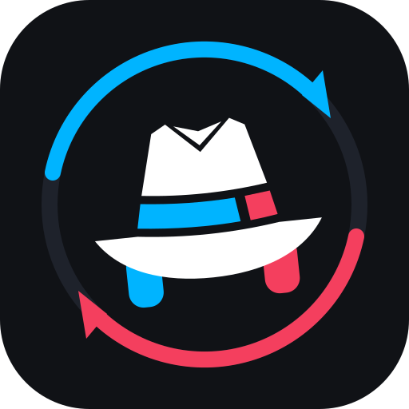

<p align="center">
  
</p>

# ChoreoLoop

[](https://github.com/LycosLane/choreoloop)
[](https://github.com/LycosLane/choreoloop)
[](LICENSE)
[]()
[]()

> **Practice choreography on your own terms.**  
> A fast, offline-first dance practice studio and A-B looper built as a lightweight PWA.  
> *No account, no ads, and zero tracking.*

---

## Features

* **Local Files (+ File):** Play audio (`MP3`, `M4A`, `WAV`, `AAC`, `OGG`) and video (`MP4`, `MOV`, `WebM`) directly on your device. Choose between caching a local copy in IndexedDB for instant offline access or streaming large videos with 0 MB browser storage.
* **YouTube Practice (+ YouTube):** Paste any YouTube link or share directly from the YouTube app on Android to practice with A-B looping, speed presets, and count-in.
* **A-B Loop Studio:** One-tap `Set A`, `Set B`, `Loop`, `Restart A`, fine-tune steppers (`0.1s`, `0.25s`, `0.5s`), and 1-tap named loop bookmarks (`Intro`, `Verse`, `Chorus`, `Bridge`, `8-Count`, or custom).
* **Slow-Motion (Pitch Preserved):** Quick presets (`0.5x`, `0.75x`, `0.9x`, `1.0x`), `-5%` / `+5%` steppers, and a continuous slider (`0.25x` to `1.25x`).
* **Mirror, Zoom & Fullscreen:** Horizontal video mirror (`scaleX(-1)`), 2-finger pinch-to-zoom (`1x` to `3x`) and pan, plus a fullscreen stage with an auto-hiding HUD.
* **Count-In & Tap Tempo:** Silent visual countdown (`3s` or `5s`) or beat-synced count-in (`1-16` beats) with live **Tap Tempo**, selectable studio percussion (`Wood`, `Click`, `Beep`), volume control, and `Each Loop` repeat.
* **Studio Ready:** Screen Wake Lock keeps your display awake during breaks, MediaSession supports Bluetooth headphones and remotes, and Light/Dark themes adapt the app icon.

---

## Local Files vs. YouTube Links

| Feature | Local File | YouTube Link |
| :--- | :--- | :--- |
| **Works Offline** | Yes (with Keep Copy on) | Not supported by YouTube |
| **Mirror Mode & Fullscreen** | Yes | Not supported by YouTube |
| **Slow-Motion Speed** | Smooth `0.25x` - `1.25x` | Fixed API steps (`0.25x`, `0.5x`, `0.75x`, `1.0x`, `1.25x`) |
| **A-B Loop & Bookmarks** | Yes (frame-accurate) | Yes (online buffering) |

---

## Install as an App & Offline Use

* **iPhone / iPad (Safari):** Tap **Share** -> **Add to Home Screen**.
* **Android (Chrome / Samsung Internet):** Tap browser **Menu** -> **Install app** / **Add to Home screen**.
* **Icon Tip:** Switch between Dark Mode (White Fedora) and Light Mode (Black Fedora) before saving to your Home Screen.
* **Offline Tip:** Refresh once while online before heading into a studio without mobile data. Your local library and bookmarks are never deleted on refresh.

---

## Privacy & Storage

* **100% Private:** Nothing is uploaded to any server. All files, loops, and settings stay inside your browser's local storage.
* **Original Files Untouched:** Removing a track in ChoreoLoop only deletes ChoreoLoop's entry or cached copy. Your original file on your phone or SD card is never modified or deleted.
* **Keep Copy vs. Stream Mode:** For large files (> 250 MB) or caches (> 500 MB), ChoreoLoop lets you stream with 0 MB cache. Due to iOS and Android browser security, streamed files must be re-selected after an app restart, while your saved loops and settings auto-restore automatically.

---

## Local Development

```bash
npm install
npm run dev
```

Build for production:

```bash
npm run build
npm run preview
```

## License

MIT License © 2026 LycosLane
